<!-- Banner -->

  
  
  

 

<!-- Who am I? -->

**Who Am I?**

**CS student at Jain University.** I don't hand-write every line, I **direct, review and ship**. AI types, I make the calls, and I own the result.

I build **full-stack apps and backend APIs** with `Python`, `FastAPI`, `React`, `Node.js` and `Docker`, and I'm exploring **applied ML** by turning ideas into working projects instead of collecting half-finished repos. I also keep **daily tech notes** because learning that isn't written down gets forgotten.

**Community builder at FOSS GLUG**, connecting developers and getting people to build together instead of alone.

Goal: become a **strong software engineer** who ships real things.

 

  

 

<!-- badges -->

  <strong>You can Click here</strong>
   

  <!-- LinkedIn -->
  
  <!-- GitHub -->
  

 

  

> [!CAUTION]
>
> Code is never finished, it only gets **better**.
>
> What you see here is built with **practice**, **curiosity**, and **persistence**.

 

<!-- My contributions title -->

 
 

  

<table align="center">
  <tr>
    <!-- Skills Left -->
    <td valign="top" width="45%">
      
       
       
       
       
       
       
    </td>
    <!---->
    <td valign="top" width="55%">
      

    </td>
  </tr>
</table>

  
  <h3>"Build. Learn. Break things. Build better."</h3>
  <i>Still learning. Still building. Never done.</i>
   
   
  

